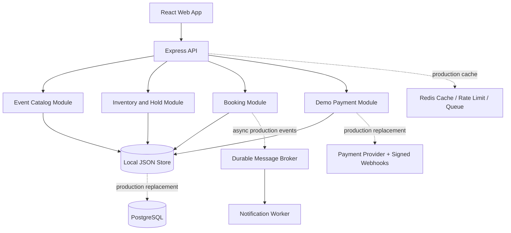

# Eventora — Event Ticket Booking MVP

A runnable event-ticket booking application with event search, event details, ticket selection, temporary inventory holds, demo checkout, booking confirmation, and booking-status lookup.

## Stack

- React + Vite + TypeScript frontend
- Express + TypeScript API
- Local JSON persistence for zero-setup demo
- Atomic in-process inventory reservation logic and idempotency support
- Demo payment flow only — no real money is charged

> **Important scope note:** This is a complete local demonstration/MVP, not a production deployment proven to support millions of concurrent users. For production, replace the local JSON store with PostgreSQL transactions, Redis for cache/rate limits/queues, durable message broker/outbox, real authentication hardening, and a payment provider with signed webhooks. The API uses a single server process and is not horizontally scalable as-is.

## Requirements

- Node.js 20 or newer
- npm

No Docker or database installation is required for this demo.

## Run on Windows PowerShell

From this folder:

```powershell
npm run setup
npm run dev
```

Open:
- Frontend: http://localhost:5173
- API health: http://localhost:4000/api/health

If PowerShell blocks scripts, run commands in Command Prompt or use `npm.cmd`.

## User journey

1. Search/filter the seeded events on the home page.
2. Open an event and choose a ticket type and quantity.
3. Create a five-minute hold. The API reserves inventory before returning the hold.
4. Choose **Pay with demo success** or **Simulate payment failure**.
5. A successful demo payment confirms the booking; failure releases the hold.
6. Open **My bookings** and search by booking reference to check status.

No account is required in this demo. Bookings are associated with a demo user ID in local storage; do not use real personal or payment data.

## Architecture



## Sync vs async

| Workflow | MVP behavior | Production recommendation |
|---|---|---|
| Search events / event details | Synchronous HTTP | CDN/cache + catalog service |
| Create hold | Synchronous HTTP | Inventory service + atomic PostgreSQL transaction |
| Start demo payment | Synchronous HTTP | Create provider checkout, then wait for webhook |
| Booking confirmation | Synchronous demo transition | Durable `PaymentSucceeded` event / idempotent consumer |
| Notifications / analytics | Not sent externally | Async broker + retry + dead-letter queue |

## Data and cache strategy for production

- **PostgreSQL**: users, events, ticket types, holds, bookings, payments, and audit history. Use transactions, conditional inventory updates, foreign keys, and uniqueness constraints.
- **Redis**: hot catalog cache, rate limits, queue backend, and short-lived hold lookups. Never treat cached availability as authoritative for the final purchase.
- **Message broker**: Kafka or RabbitMQ for `BookingCreated`, `PaymentSucceeded`, `BookingConfirmed`, and `NotificationRequested`. Use idempotent consumers, retry with backoff, dead-letter handling, and transactional outbox.
- **Search**: PostgreSQL full-text search for initial scale; OpenSearch/Elasticsearch for advanced search at larger scale.
- **Media**: object storage + CDN for event posters.

## Preventing double booking

This demo serializes inventory-changing operations in one Node process and validates inventory before reserving. That is useful for a local demonstration but **does not protect multiple server replicas or survive all process crashes**. Production must perform a conditional atomic update or row lock in a PostgreSQL transaction, e.g. reserve only where `total_quantity - reserved_quantity - sold_quantity >= requested_quantity`. Seat IDs must have database-level uniqueness for active holds/sales. Hold expiry and payment confirmation must be idempotent and race-safe.

## Flash-sale protection plan

- CDN for static assets and cached public event pages.
- WAF/bot protection and a virtual waiting room.
- Rate limits by IP, account, and endpoint.
- Per-user purchase caps, idempotency keys, bounded queues, and admission control.
- Short catalog cache TTLs with jitter, request coalescing, and cache prewarming.
- Keep checkout fail-closed when inventory cannot be authoritatively verified.
- Bounded DB pools, request timeouts, backpressure, and circuit breakers.
- Autoscaling, dashboards, alerting, and load tests before launch.

Do not claim millions of concurrent users without representative load tests on the deployed infrastructure.

## API endpoints

- `GET /api/health`
- `GET /api/events?q=&category=&city=&page=&limit=`
- `GET /api/events/:id`
- `GET /api/events/:id/availability`
- `POST /api/holds`
- `GET /api/holds/:id`
- `DELETE /api/holds/:id`
- `POST /api/payments/checkout` — demo payment success/failure
- `GET /api/bookings?userId=`
- `GET /api/bookings/:reference`

## Demo limitations

- Demo payment is not a real payment integration.
- Demo identity is a browser-generated ID, not secure authentication.
- JSON file persistence is intended for a single local process, not production concurrency or multi-instance use.
- Demo QR-like code is not a valid venue-entry credential.
- Notifications are not sent.
